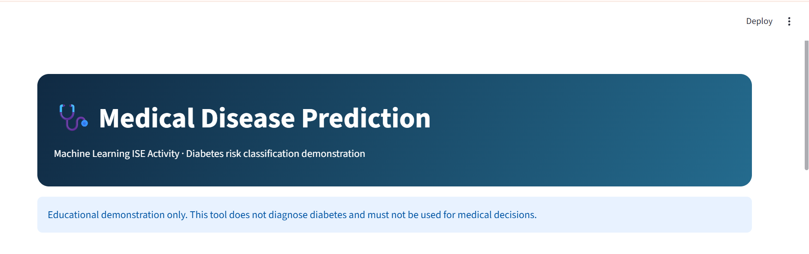
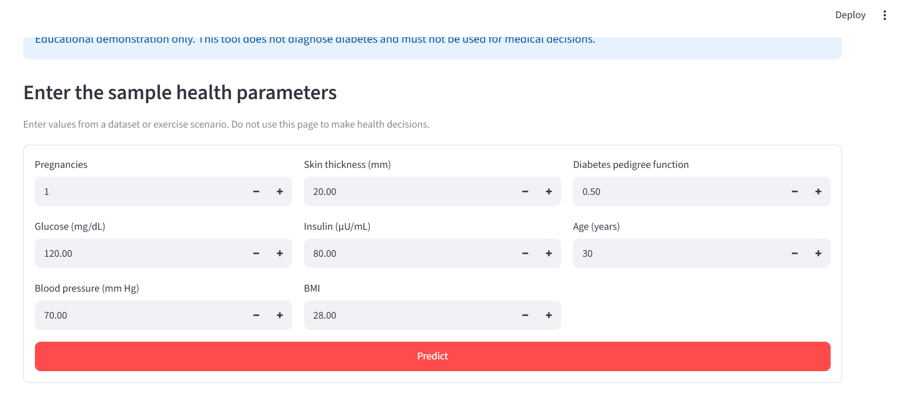
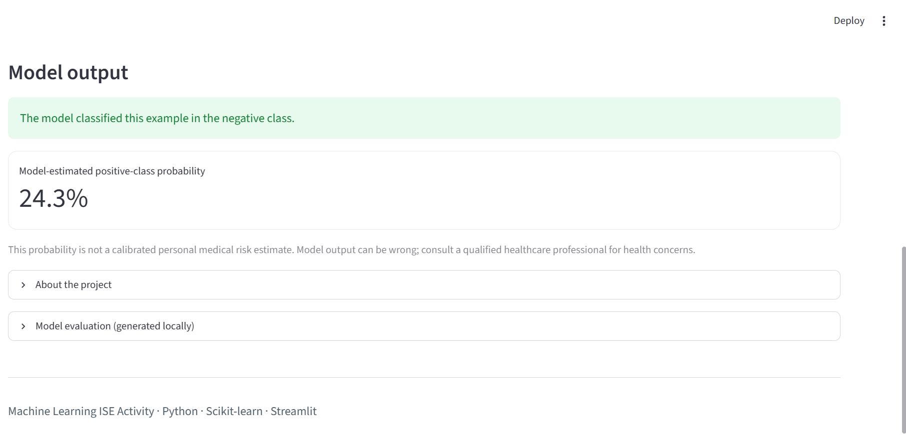

<div align="center">

# 🩺 Medical Disease Prediction

### *Machine Learning ISE Activity · Diabetes Classification Demonstration*

<p>
  
  
  
  
</p>

<p>
  A student machine-learning project that trains a classifier on a public diabetes dataset<br/>
  and presents sample predictions through an interactive web interface.
</p>

</div>

---

## 📸 Project Preview

<div align="center">
  
  <br/><br/>
  <em>Application landing page and educational-use notice</em>
</div>

---

## 🎯 Objective

To demonstrate the basic machine-learning workflow for a **binary classification** task: preparing a dataset, handling selected missing measurement values, training and evaluating a model, and connecting the trained model to a simple web interface.

> **Important medical disclaimer:** This project is for education only. It is not a medical device, does not diagnose diabetes, and is not clinically validated. Its output must not be used for treatment or healthcare decisions. Consult a qualified healthcare professional for medical concerns.

## ✨ Key Features

<table>
<tr>
<td width="50%">

### 🧠 Machine Learning
- Random Forest classifier
- Median imputation for missing values
- Stratified train/test split
- Fixed random seed for reproducible demonstration

</td>
<td width="50%">

### 📊 Model Evaluation
- Accuracy, precision, recall and F1-score
- Confusion matrix
- Classification report
- Metrics report generated locally after training

</td>
</tr>
<tr>
<td width="50%">

### 🖥️ Interactive Web App
- Streamlit-based user interface
- Eight sample input parameters
- One-click prediction
- Displays model class and estimated positive-class probability

</td>
<td width="50%">

### 📁 Project Workflow
- Dataset download on first training run
- Saved model file for app inference
- Requirements file for dependency installation
- Screenshots included for project documentation

</td>
</tr>
</table>

## 🖥️ Application Screenshots

### 1. Homepage and Project Notice


### 2. Sample Health-Parameter Input Form



### 3. Model Output



*The screenshots show the application interface and an example output. The displayed prediction is a model result for the entered example, not a diagnosis or a reliable personal medical-risk estimate.*

---

## 🧰 Technology Stack

<p align="center">
  
  
  
  
  
</p>

| Technology / Tool | Purpose |
|---|---|
| Python | Main programming language |
| Pandas and NumPy | Dataset loading and data preparation |
| Scikit-learn | Preprocessing pipeline, model training and evaluation |
| Random Forest | Supervised classification algorithm |
| Joblib | Saving and loading the trained model |
| Streamlit | Interactive web interface |
| Git and GitHub | Version control and project submission |

## 📚 Dataset

This project uses the **Pima Indians Diabetes dataset**, an educational benchmark with eight input features and a binary target label.

- **Input features:** Pregnancies, Glucose, Blood Pressure, Skin Thickness, Insulin, BMI, Diabetes Pedigree Function and Age.
- **Target:** `Outcome` (`0` or `1` in the source dataset).
- **Download behaviour:** `train_model.py` attempts to download the CSV on the first training run if `dataset/diabetes.csv` is not already present.
- **Population limitation:** The dataset represents a specific population and is not representative of everyone. This limits how broadly its results can be interpreted.

Dataset source/mirrors used by the training script:
- [Pima Indians Diabetes Dataset repository](https://github.com/npradaschnor/Pima-Indians-Diabetes-Dataset)
- [Plotly datasets mirror](https://github.com/plotly/datasets)

The script treats zero values in selected measurement fields (Glucose, Blood Pressure, Skin Thickness, Insulin and BMI) as missing values before median imputation. This is a dataset-specific preprocessing choice, not a universal medical rule.

## 🚀 Getting Started

### Prerequisites

- Python installed on Windows, macOS or Linux
- Internet access for the initial dataset download
- A terminal such as VS Code PowerShell

### 1. Extract and open the project

Extract the ZIP file, then open the `Medical-Disease-Prediction` folder in VS Code.

### 2. Create a virtual environment (recommended)

**Windows PowerShell**
```powershell
py -m venv .venv
.\.venv\Scripts\Activate.ps1
```

If PowerShell blocks activation, you can use the environment's Python directly:
```powershell
.\.venv\Scripts\python.exe -m pip install --upgrade pip
.\.venv\Scripts\python.exe -m pip install -r requirements.txt
```

**macOS / Linux**
```bash
python3 -m venv .venv
source .venv/bin/activate
python -m pip install --upgrade pip
python -m pip install -r requirements.txt
```

> **Windows note:** If `python` points to an MSYS2 installation that reports `No module named pip`, use the Windows Python launcher (`py`) or the virtual-environment Python path instead. For example: `py -m pip install -r requirements.txt`.

### 3. Install dependencies

```powershell
py -m pip install -r requirements.txt
```

If you activated the virtual environment, use:
```powershell
python -m pip install -r requirements.txt
```

### 4. Train and evaluate the model

```powershell
py train_model.py
```

On the first run, an internet connection is needed to fetch the dataset. The script trains the model, prints evaluation results, and creates:
- `models/diabetes_model.joblib`
- `model_metrics.txt`
- `dataset/diabetes.csv`

### 5. Run the web application

```powershell
py -m streamlit run app.py
```

Streamlit prints a local address in the terminal, usually `http://localhost:8501`. Open that address in your browser.

---

## 🧪 Sample Input and Output

The application starts with the following example values:

| Input feature | Example value |
|---|---:|
| Pregnancies | 1 |
| Glucose | 120 mg/dL |
| Blood Pressure | 70 mm Hg |
| Skin Thickness | 20 mm |
| Insulin | 80 µU/mL |
| BMI | 28.0 |
| Diabetes Pedigree Function | 0.50 |
| Age | 30 years |

**Example output shown in the supplied screenshot:** the model classified the example in the negative class and displayed a positive-class probability of **24.3%**.

This is only the output visible in that screenshot. Predictions and probability values may differ if the model, dataset, dependencies or training run changes. The probability is not a calibrated personal medical-risk estimate.

## 📈 Model Training and Evaluation

The training script follows this workflow:

1. Load the dataset from `dataset/diabetes.csv`, or attempt to download it.
2. Convert feature values to numeric values and remove invalid target rows.
3. Treat selected zero measurements as missing values.
4. Split the data into **80% training** and **20% testing**, using stratification and `random_state=42`.
5. Apply median imputation and train a Random Forest classifier.
6. Evaluate predictions on the held-out test split.
7. Save the trained model and a text evaluation report.

The local report contains:
- Accuracy
- Precision
- Recall
- F1-score
- Confusion matrix
- Classification report

**Actual evaluation metrics are generated by running `py train_model.py`.** They are not hard-coded into this README, because they should reflect the dataset and model run on the user's system. Accuracy alone is not enough to assess a medical classifier; the other metrics and dataset limitations should also be considered. A held-out test score does not establish clinical validity.

## 🗂️ Project Structure

```text
Medical-Disease-Prediction/
├── app.py                         # Streamlit web interface
├── train_model.py                 # Dataset download, training and evaluation
├── requirements.txt               # Python dependencies
├── README.md                      # Project documentation
├── START_HERE.txt                 # Quick-start instructions
├── .gitignore                     # Files excluded from Git
├── dataset/
│   └── diabetes.csv               # Downloaded during training
├── models/
│   └── diabetes_model.joblib      # Generated trained model
├── screenshots/
│   ├── 01-homepage.png             # App header and disclaimer
│   ├── 02-input-form.png           # Input form
│   └── 03-model-output.png         # Example model output
└── model_metrics.txt              # Generated evaluation report
```

*The dataset, trained model and evaluation report are generated locally when you run the training script; they may not exist in a fresh source-code download.*

## ✅ Results

The project provides a complete educational demonstration from dataset preparation through model training, evaluation and interactive prediction. The supplied screenshots document the running interface. Numeric evaluation results are written to `model_metrics.txt` after training and should be reported from that generated file.

## 🧾 Conclusion

This project demonstrates the use of supervised machine learning for a binary classification exercise and shows how a trained model can be integrated into a simple web application. It also highlights the importance of preprocessing, evaluation metrics, reproducibility and responsible interpretation of outputs. Because the dataset is limited and the model is not clinically validated, the application must remain an educational demonstration.

## 📤 GitHub Submission Checklist

Before submitting the repository for the Machine Learning ISE activity:

- [ ] Confirm `py -m pip install -r requirements.txt` completes successfully.
- [ ] Run `py train_model.py` and confirm the model and metrics report are created.
- [ ] Run `py -m streamlit run app.py` and test the input form.
- [ ] Keep the three application screenshots in the `screenshots/` folder.
- [ ] Check `model_metrics.txt` and include the actual values in your presentation/report if required.
- [ ] Push the project files and README to a **public GitHub repository**.
- [ ] Verify that the README screenshots render on GitHub.
- [ ] Do not upload `.venv/`, Python cache files or other unnecessary generated files.

## 📄 License

This repository is prepared as an academic learning activity. Unless a separate license is added to the repository, reuse permissions are not explicitly granted by this README.

---

<div align="center">

**Machine Learning ISE Activity**  
*Python · Scikit-learn · Random Forest · Streamlit*

</div>
